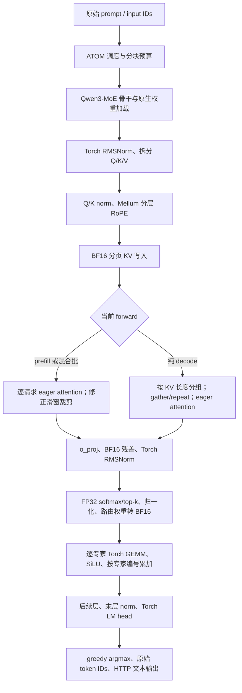

# Mellum 精度版全链路审查

日期：2026-11-05。对象：`run_mellum_eager_precision.sh`，冻结 Torch 2.10，BF16；参考为官方 Transformers 5.20.2 的原生 Mellum eager attention / eager experts。速度版保持原状，没有 Git 提交。

**结论：当前单条精度路径能够与 HF 对齐。场景 A 的大幅分叉有两条已验证的来源：批量/分块形状改变 BF16 运算结果，以及精度版分块 prefill 的滑窗 KV 长度未对齐 HF。后一处已修正。尚不能宣布 32 并发达到 90%。**

10 条 A 难例分别按两种相同执行方式对照：

| 执行方式 | 修正后 ATOM 对对应 HF | 完整一致 |
|---|---:|---:|
| 单条、整段 prefill、生成 64 token | 640/640，100% | 10/10 |
| 单条、1024 分块 prefill、生成 64 token | 640/640，100% | 10/10 |
| HF 整段 prefill 对 HF 1024 分块 | 276/640，43.125% | 2/10 |

这 10 条专门从之前 A512 的分歧样本中选取，属于诊断集；43.125% 不能推广为 HF 在所有数据上的一致率，也不能替代正式 200 条验收。ID：A-0007、0126、0138、0301、0150、0006、0016、0026、0041、0049。

**实际调用链**



入口先通过 `mellum_eager_precision.install()` 接入替换。部分历史函数仍叫 `naive_sdpa` / `batched_sdpa`，但本入口运行时绑定的算术是 eager QK → scale → mask → FP32 softmax → BF16 PV，不能仅凭函数名称判断用了 SDPA。模型侧 `enforce_eager` / 编译等级 0 与 attention 的 eager 实现是两个不同配置，当前二者均核对。

**逐环节审查**

| 环节 | 发现与证据 | 判断 |
|---|---|---|
| 环境、HF 源码 | 新实验的模型计算均为冻结 Torch 2.10；HF 官方 wheel 中 2764 个 `.py` 文件逐字节核验，无修改或缺失 | 未发现 HF 被改坏 |
| 输入、tokenizer | 采用 A 原始 input IDs；HF 原场景 tokenizer 的左 pad ID 为 **0**；真实输入、截断位置、无 chat template 的口径一致 | 没有输入错配证据 |
| 模型结构、层选择 | 28 层均为 sparse MoE；21 层 SWA、7 层全局 attention，逐层读取配置 | 未发现稀疏层/滑窗层误选 |
| 权重加载 | 将 ATOM packed QKV 拆回、专家参数改为对应名称后，两端 **311/311 参数张量**的形状、dtype、全部字节 SHA256 相同 | 排除本 checkpoint 专家错映射、shuffle、漏加载 |
| 调度、prefill | HF A32 左 padding 到最长序列，再切 1024 块；ATOM 无 padding，按 16384 总 token 预算打包和切块 | 确认执行形状不同，直接影响数值 |
| norm、残差 | BF16 残差相加，FP32 RMS 归约，再转回 BF16 并乘权重；同执行方式的逐层记录一致 | 未发现新的舍入边界错误 |
| Q/K/V、o_proj | 已拆分 QKV，权重相同；同输入只改变 GEMM 行数即可复现微小差异 | 独立的批量数值差异来源 |
| RoPE、Q/K norm | 使用按 attention 类型区分的 RoPE/YaRN；频率 FP32、角度计算与最新 HF 相同；旋转后 Q/K 对照通过 | 未发现配置或位置偏移错误 |
| SWA、因果 mask | 可见范围都是 `q-1023 ≤ k ≤ q`；旧分块路径保留过多已遮蔽 KV，矩阵长度不同 | **已修正 KV 计算范围** |
| 分页 KV | 原生 cache write、非连续物理页 gather、4→32 头复制，在 20 组检查中全部逐位一致；另有 6 组因果/窗口边界检查 | 未发现错页、错头或窗口越界 |
| 路由 | FP32 softmax/top-k/归一化后转 BF16，与 HF 一致；输入微变后会改变部分专家选择 | 未发现重复的路由权重 dtype 错误；存在放大效应 |
| 专家计算 | prefill 用 Torch 循环；decode 用按 HF 顺序打包的逐专家 GEMM与逐次 BF16 舍入合并；同执行方式的输出一致 | 专家接收行数变化会改变 GEMM 结果 |
| 末层、logits | 同执行方式下最终 hidden、norm 与完整 logits 一致；并发下差异在前面的层已产生 | LM head 不是本例的首个差异点 |
| 采样 | 6 组路径共 48 个记录位置，生成 ID 均等于原始 logits 的 argmax；并列最大时按最小 token ID 选择 | 不是随机采样导致 |
| 输出与评分 | 原始 token ID 对齐评分；之前 A512 有 3 条逐 chunk Unicode 解码问题 | 是独立文本输出缺陷，不解释 token ID 一致率低；本轮未改公共 HTTP 接口 |

“通过”限于本次 checkpoint、运行配置与覆盖样本，不表示所有模型、并行方式或未来 MTP 路径都已验证。当前 MTP、prefix cache、量化均关闭。

**定位样本 A-0126：从哪里开始不同**

输入为 3857 token。单条、无 padding、整段 prefill 时，ATOM 与 HF 前 8 步记录的 **3696 个张量全部逐位相同**。记录包含每层最后一个查询位置的子模块/真实残差边界，以及第 0、3、27 层的完整 KV、旋转后 Q 和 mask；这不代表保存了所有层所有 prompt 位置的全部中间量。针对最前两层，另补抓了完整 prompt 的逐算子输出。

完整位置对照发现，分块/批量变化的首次差异已经出现在 **第 0 层 Q/K/V 投影**，并非到后层才突然出错。独立算子回放使用完全相同的 normalized hidden 和权重，将整段矩阵改为 1024 行分块：

| 投影 | 不同元素数 / 总数 | 最大绝对差 |
|---|---:|---:|
| Q | 1160 / 15,798,272 | 0.0001220703125 |
| K | 200 / 1,974,784 | 0.00000095367431640625 |
| V | 433 / 1,974,784 | 0.000244140625 |

直接回放的整段输出与 HF 原始记录逐位一致。这证明差异不需要缓存、调度错位或错误权重就能出现。已验证的是 Torch BF16 `F.linear` 对形状的数值敏感性；本轮没有追踪到具体的 hipBLAS/hipBLASLt kernel ID，不能把某个底层内核名称当作已证明根因。

专家侧也做了同输入回放：目标 token 的 2304 维输入、8 个专家编号和 BF16 权重均相同。第 18 号专家在两种组织下分别接收 4 行和 115 行，gate/up、激活、down、加权结果产生微小差异，加权最大差为 0.00000762939453125。其他 token 不会在数学上混入目标 token，但它们会改变专家 GEMM 的行数和数值计算组织。

这种差异会沿残差、attention 和离散 top-k 路由传播。对该 prompt 的首个输出位置，HF 单条整段与 HF A32 分块相比，第 3/7/15/27 层边界 hidden 的相对 L2 差约为 0.99% / 3.41% / 9.39% / 19.25%。因此不能把最终较大的 hidden/logits 差异简单解释成权重加载或结构完全错误。

| A-0126 的 HF 执行方式 | 前 4 个输出 token ID |
|---|---|
| 单条，整段，无 padding | 4223, 984, 302, 2370 |
| 单条，1024 分块，无 padding | 4223, 984, 302, 5144 |
| 单条，左 pad 到 4113，整段 | 4223, 984, 302, 5144 |
| 单条，左 pad 到 4113，1024 分块 | 470, 2677, 359, 5003 |
| 原 A32 批次，左 pad，1024 分块 | 470, 2677, 359, 3182 |

最后一行已用无 hook 主线程、工作线程、预热后工作线程分别复现，与之前正式 A 保存的该批前缀一致。记录 hook 没有改变这个结果。初轮另有使用 pad ID 28 的辅助实验，已单列为 `*-pad28.*`，不作为实际 A 参考。

A32 的首 token logits 中，470 和 4223 都是 25.0，greedy 取 470；HF 单条整段中二者分别为 21.75 和 22.25，greedy 取 4223。采样器是在忠实反映上游 logits 的变化。

**已落实的修正**

唯一生产实现改动：`/workspace/tools/mellum_eager_precision/install.py`，`eager_one()` 第 16 行起。

```python
shift = max(0, len(k) - len(q) - window + 1) if window is not None else 0
if shift:
    k, v, kpos = k[shift:], v[shift:], kpos[shift:]
```

对连续查询块，保留“至多 W-1 个历史 key + 当前 query 块”，与 HF `DynamicSlidingWindowLayer` 相同。这里不是仅保留最后 W 个 key；当前块可能有多条 query，最早 query 所需的历史必须保留。全局层不裁剪，首块无多余历史时不裁剪；纯 decode 原有窗口裁剪保持原路径。

例如 past=1024、当前块=1024、W=1024，旧路径计算 2048 个 key，HF 为 2047；past=3072、当前块=785 时，旧路径为 3857，HF 为 1808。旧 mask 的可见性没有漏屏蔽，但较长矩阵不满足数值对齐要求。

控制实验：固定相同分块，修正前从第二块出现张量差异；修正后 4 个 prefill 块及后续 7 个 decode forward 的 **5082 个记录张量全部逐位一致**。随后使用实际安装的修正版完成上述两组 10×64 回归。不能把这个局部修正描述成已解决全部动态批处理差异。

**当前验收含义与下一步**

1. 当前已证明：精度路径在相同的单条执行条件下可以对齐原生 HF；新的 A 难例两种 prefill 方式均通过。之前“场景 A 差异大，因此精度版模型结构一定不对”的解释不成立。
2. 之前正式 A512 的 34.5367% 是两种不同调度/矩阵形状下的自由生成比较，仍是该实验的真实结果。修正后没有重跑完整 A512 或正式 200 条，不能覆盖旧结果，也不能声称并发已过 90%。
3. 按已确认的题面分别验收，正确性参考必须同时固定 Torch、HF attention/experts、BF16、prompt/tokenization、单条/批量、padding、prefill 分块和 EOS 策略。只写“HF eager、greedy”不足以唯一确定参考。
4. 如果后续要提高并发对单条 HF 的一致率，需要控制投影、专家 GEMM、attention 的计算形状，再逐项消融；只把全部算术改成 FP32，也不保证与原生 BF16 HF 的 token 相同。提速时优先保留已验证的舍入边界和执行组织。

补充修正后的离线 32 请求短回归：32/32 成功，每条输出 32 token。与修正前相同请求队列相比，711/1024 个位置相同；对 HF 相同静态批次的前 8 token 为 187/256（73.046875%）。这是短程回归，不能当作正式 A32/前64 的验收成绩。它也说明裁剪会改变旧批量结果，但尚未消除 padding、GEMM 行数、调度和分块造成的差异。

本轮没有做新的性能测量，不把带张量拷贝的诊断时间当作吞吐成绩。速度版及其依赖已对上一轮快照逐文件核验，保持不变。结束后两卡上的本轮测试进程均已退出。

**文件、证据与复现**

服务器实验目录：`/workspace/results/mellum_chain_audit_20261105/`。

| 文件 | 作用 |
|---|---|
| `source-before/install.py`、`source-after/install.py`、`prefill-swa.patch` | 唯一生产补丁的前后副本与 diff |
| `code/hf_audit*.py`、`hf_replay.py` | HF 执行方式矩阵、逐层记录、无 hook 复现 |
| `code/atom_audit.py`、`atom_batch.py` | ATOM 单条/批量逐层与元数据记录 |
| `code/atom_chunk_control.py`、`atom_chunk_crop.py`、`crop_patch.py` | 相同分块下的修正前后控制实验；control 显式加载 `source-before` 的旧 attention 计算 |
| `code/hf_ops.py`、`op_compare.py`、`op_replay.py` | 前两层全位置记录、同输入算子回放 |
| `code/hf_quick10.py`、`atom_quick10.py`、`quick10-review.json` | 两种 prefill 方式的 10 条回归及汇总 |
| `code/atom_batch_regression.py`、`batch-regression-review.json` | 已安装修正版的离线 32 请求短回归 |
| `code/cache_probe.py`、`cache-probe.json` | 非连续页、窗口边界、native write/gather/repeat 检查 |
| `sampler-review.json`、`weight-comparison.json`、`official-hf-source-check.json` | 原始 argmax、完整参数字节、官方源码审计 |
| `source-snapshot/`、`source-manifest.json`、`speed-source-check.json` | 调用链源码快照及不变性检查 |

完整 `.pt` 张量保留在服务器；本地 `server-step0/mellum-chain-audit/evidence/` 保存代码、JSON、日志与补丁。结果以原始 ID 和张量记录为准，失败的诊断工具启动日志保留且不计入通过结果。
